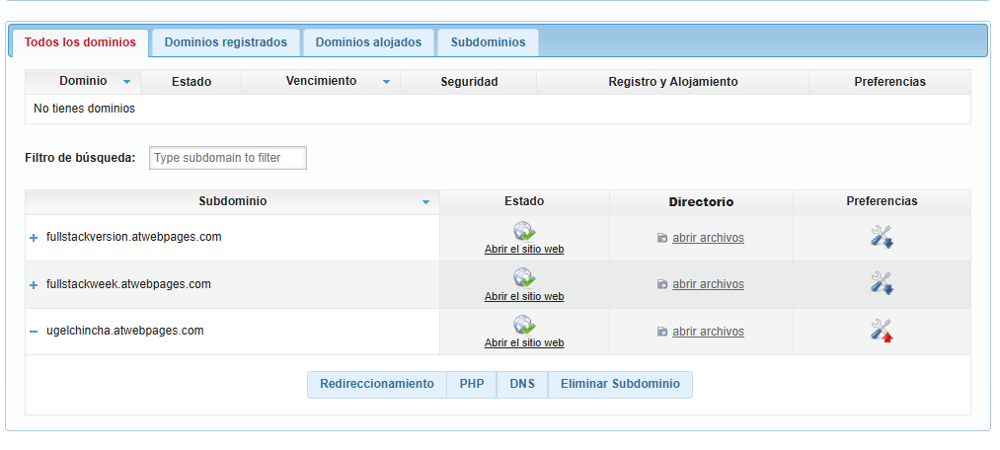
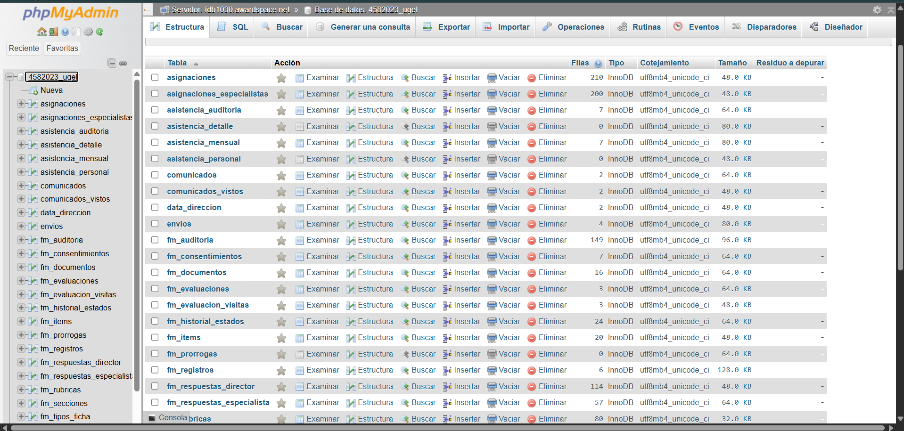
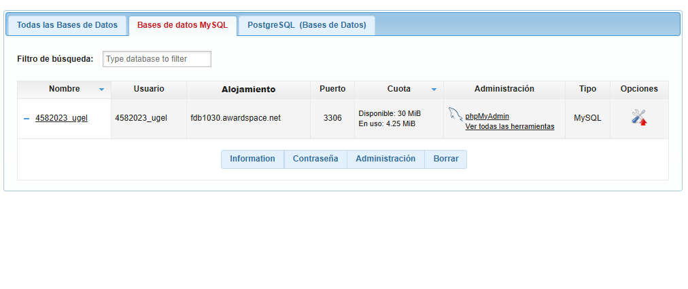
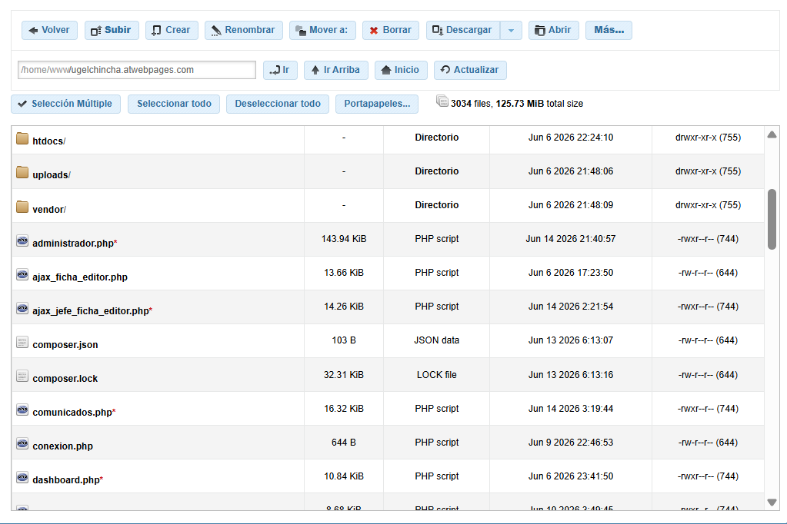

# 📚 Sistema Documental UGEL Chincha

**Plataforma integral de gestión documental y monitoreo educativo para la Unidad de Gestión Educativa Local de Chincha.**

## 🛠️ Stack Tecnológico


Sistema web escalable que permite la administración centralizada de usuarios, instituciones educativas, documentación, comunicados y fichas de monitoreo/evaluación. Diseñado con roles diferenciados (administrador, director, docente, especialista, jefe AGP) y herramientas de análisis interactivo con gráficos y reportes dinámicos.

---

## 📋 Tabla de contenidos

- [Características](#características)
- [Stack tecnológico](#stack-tecnológico)
- [Estructura del proyecto](#estructura-del-proyecto)
- [Requisitos del sistema](#requisitos-del-sistema)
- [Instalación local](#instalación-local)
- [Configuración de FTP automático en VS Code](#configuración-de-ftp-automático-en-vs-code)
- [Base de datos](#base-de-datos)
- [Configuración de conexión](#configuración-de-conexión)
- [Rutas principales](#rutas-principales)
- [Módulos del sistema](#módulos-del-sistema)
- [Despliegue en AwardSpace](#despliegue-en-awardspace)
- [Notas de seguridad](#notas-de-seguridad)
- [Solución de problemas](#solución-de-problemas)
- [Créditos](#créditos)

---

## ✨ Características

### Funcionalidades principales
- ✅ **Autenticación segura** por DNI y contraseña con gestión de sesiones
- ✅ **Paneles diferenciados por rol** con permisos granulares (administrador, director, docente, especialista, jefe AGP)
- ✅ **Administración integral** de usuarios, instituciones y asignaciones
- ✅ **Sistema de documentos** con registro, revisión y observaciones de envíos
- ✅ **Publicación de comunicados** con seguimiento de lecturas
- ✅ **Fichas de monitoreo** con consentimientos, prorrogas, evaluaciones y constancias
- ✅ **Generación de reportes dinámicos** con filtrado interactivo y visualización de datos
- ✅ **Exportación de datos** a formatos PDF y Excel
- ✅ **Asistencia mensual** con control y reporte integrado
- ✅ **Sincronización automática** vía FTP con servidor de producción

---

## 🛠 Stack tecnológico

| Componente | Versión | Descripción |
|---|---|---|
| **PHP** | 8.1+ | Lenguaje de servidor |
| **MySQL/MariaDB** | 8.0+ | Base de datos relacional |
| **MySQLi** | Nativa | Driver para conexión a BD |
| **Bootstrap** | 5.x | Framework CSS responsive |
| **DOMPDF** | Última | Generación de PDFs desde HTML |
| **PhpSpreadsheet** | Última | Exportación a Excel |
| **Composer** | Última | Gestor de dependencias PHP |
| **SFTP/SSH** | OpenSSH | Sincronización automática |
| **Hosting objetivo** | AwardSpace | Servidor de producción |

---

## 📁 Estructura del proyecto

```
ugel_system_dev/
│
├── htdocs/                              # Raíz pública de la aplicación PHP
│   ├── .vscode/
│   │   └── sftp.json                    # Configuración automática FTP/SFTP ⭐
│   │
│   ├── index.php                        # Página de entrada (redirección al login)
│   ├── login.php                        # Módulo de autenticación
│   ├── logout.php                       # Cierre de sesión
│   ├── conexion.php                     # Configuración de conexión a BD
│   │
│   ├── administrador.php                # Panel administrativo
│   ├── dashboard.php                    # Panel de usuarios institucionales
│   ├── dashboard_especialista.php       # Panel de especialistas
│   ├── dashboard_jefe_agp.php           # Panel de jefe AGP
│   ├── panel_usuario.php                # Panel personalizado por rol
│   │
│   ├── enviar_documento.php             # Registro de documentos
│   ├── ver_envios.php                   # Revisión de envíos
│   ├── procesar_envio.php               # Procesamiento de envíos
│   │
│   ├── comunicados.php                  # Visualización de comunicados
│   ├── Publicacion_Comunicados.php      # Gestión de comunicados
│   │
│   ├── ficha_monitoreo_2026.php         # Fichas de monitoreo
│   ├── especialista_crear_fichas.php    # Creación de fichas por especialista
│   ├── procesar_evaluacion.php          # Procesamiento de evaluaciones
│   │
│   ├── vista_reportes.php               # Reportes dinámicos con gráficos
│   ├── jefe_descargar_zip.php           # Exportación en ZIP
│   │
│   ├── asistencia/                      # Módulo de control de asistencia
│   │   ├── schema_asistencia.sql        # Esquema específico del módulo
│   │   └── *.php                        # Vistas y controladores
│   │
│   ├── documentos_fichas/               # Almacenamiento de PDFs generados
│   ├── uploads/                         # Almacenamiento de archivos cargados
│   ├── vendor/                          # Dependencias de Composer
│   │   ├── dompdf/                      # Librería DOMPDF
│   │   ├── phpoffice/phpspreadsheet/    # Librería de Excel
│   │   └── ...
│   │
│   └── assets/                          # Recursos estáticos (CSS, JS, imágenes)
│
├── awardspace_mysql8_ugel.sql           # Esquema SQL para AwardSpace (producción)
├── bd_simulada_ugel_repositorio.sql     # Esquema SQL para desarrollo local
├── mapa_tablas_htdocs.md                # Documentación: tablas y relaciones
├── .gitignore                           # Archivos ignorados por Git
└── README.md                            # Este archivo

```

---

## 📦 Requisitos del sistema

### Entorno local (desarrollo)

- **PHP** 8.1 o superior
- **MySQL 8.0** o **MariaDB** compatible
- **Servidor web local**:
  - XAMPP (recomendado)
  - Laragon
  - Apache
  - Servidor embebido de PHP
- **Composer** para gestión de dependencias
- **Git** para control de versiones
- **VS Code** (opcional, pero recomendado para FTP automático)

### Extensiones PHP recomendadas

```
✓ mysqli       – Driver de base de datos
✓ mbstring     – Manejo de caracteres multibyte (UTF-8)
✓ gd           – Procesamiento de imágenes
✓ zip          – Compresión de archivos
✓ json         – Serialización JSON
✓ dom          – Procesamiento de XML/HTML
```

### Entorno de producción (AwardSpace)

- Acceso SFTP/SSH al hosting
- phpMyAdmin para gestión de base de datos
- Panel de control de AwardSpace

---

## 🚀 Instalación local

### 1. Clonar el repositorio

```bash
git clone https://github.com/GitHope123/ugel_system_dev.git
cd ugel_system_dev
```

### 2. Configurar la carpeta pública

```bash
cd htdocs
```

### 3. Instalar dependencias (si es necesario)

Si la carpeta `vendor/` no existe o está desactualizada:

```bash
composer install
```

Para actualizar a versiones más recientes:

```bash
composer update
```

### 4. Crear y configurar la base de datos

#### Opción A: Desarrollo rápido (recomendado para pruebas)

```bash
# Importar esquema simulado en tu gestor MySQL (phpMyAdmin, HeidiSQL, etc.)
# Archivo: bd_simulada_ugel_repositorio.sql
```

#### Opción B: Estructura cercana a producción

```bash
# Importar esquema de AwardSpace
# Archivo: awardspace_mysql8_ugel.sql
```

**Pasos en phpMyAdmin:**
1. Crea una nueva base de datos (ej: `ugelcvda_bd_repositorio`)
2. Ve a la sección "Importar"
3. Selecciona el archivo SQL deseado
4. Haz clic en "Continuar"

### 5. Configurar conexión a base de datos

Edita `htdocs/conexion.php` con tus credenciales locales:

```php
<?php
// Entorno local
$servername = "localhost";
$username = "root";
$password = "";  // Vacío para XAMPP
$dbname = "ugelcvda_bd_repositorio";

$conn = new mysqli($servername, $username, $password, $dbname);

if ($conn->connect_error) {
    die("Conexión fallida: " . $conn->connect_error);
}

$conn->set_charset("utf8mb4");
?>
```

### 6. Iniciar servidor local

```bash
# Desde la carpeta htdocs/
php -S localhost:8000
```

Alternativa con XAMPP: activa Apache desde el panel de XAMPP.

### 7. Acceder a la aplicación

Abre tu navegador en:

```
http://localhost:8000
```

Usa credenciales de prueba de la base de datos (tabla `usuarios`).

---

## 🔄 Configuración de FTP automático en VS Code

### ¿Qué es FTP automático?

El FTP automático permite **sincronizar automáticamente** tus cambios locales con el servidor de producción (AwardSpace) al guardar un archivo. No necesitas hacer `git push` ni subir manualmente vía FTP.

### Requisitos previos

1. **Extensión VS Code**: `SFTP` (por Natizyskunk) o `SFTP (Sync)`
2. **Acceso SFTP/SSH** a tu servidor (datos de AwardSpace)
3. **VS Code** abierto en la carpeta `htdocs/`

### Instalación de la extensión SFTP

#### Paso 1: Abrir VS Code
Abre VS Code y asegúrate de estar en la carpeta `htdocs/`:

```bash
code htdocs
```

#### Paso 2: Instalar la extensión
Usa el atajo de teclado:

```
Ctrl+Shift+X
```

Se abrirá la pestaña de **Extensiones**. Busca:

```
SFTP
```

Deberías ver la extensión de "**SFTP**" (autor: Natiyfikunk o similar).

**Haz clic en "Instalar"** y espera a que termine.

#### Paso 3: Recargar VS Code

Después de instalar, VS Code puede pedirte recargar. Haz clic en **"Recargar ventana"** o usa:

```
Ctrl+Shift+P → Reload Window
```

---

### Configuración del archivo `sftp.json`

El archivo de configuración ya existe en `.vscode/sftp.json`. Aquí está la estructura completa:

**Ruta:** `htdocs/.vscode/sftp.json`

```json
{
  "name": "AwardSpace UGEL",
  "host": "f30-preview.awardspace.net",
  "protocol": "sftp",
  "port": 221,
  "username": "4582023",
  "password": "8CUunqWk8Zn8@Gk",
  "remotePath": "/ugelchincha.atwebpages.com",
  "uploadOnSave": true,
  "useTempFile": false,
  "openSsh": false,
  "ignore": [
    ".git",
    "node_modules",
    ".env",
    ".vscode",
    "*.sql",
    "*.md"
  ]
}
```

#### Parámetros explicados

| Parámetro | Descripción | Ejemplo |
|---|---|---|
| `name` | Nombre descriptivo de la conexión | "AwardSpace UGEL" |
| `host` | Servidor SFTP/SSH del hosting | "f30-preview.awardspace.net" |
| `protocol` | Protocolo de comunicación (`sftp` o `ftp`) | "sftp" |
| `port` | Puerto de conexión | 221 (SFTP) ó 21 (FTP) |
| `username` | Usuario FTP/SFTP del hosting | "4582023" |
| `password` | Contraseña de acceso | "8CUunqWk8Zn8@Gk" |
| `remotePath` | Ruta en el servidor donde se suben los archivos | "/ugelchincha.atwebpages.com" |
| `uploadOnSave` | Subir automáticamente al guardar (`true`/`false`) | `true` |
| `useTempFile` | Usar archivo temporal durante la subida | `false` |
| `openSsh` | Usar SSH nativo del sistema | `false` |
| `ignore` | Archivos/carpetas que NO se sincronizan | `.git`, `*.sql`, etc. |

### Obtener credenciales de AwardSpace

Si necesitas obtener o actualizar las credenciales SFTP:

1. **Accede a panel AwardSpace** en [https://www.awardspace.com](https://www.awardspace.com)
2. Inicia sesión con tu cuenta
3. Selecciona tu dominio
4. Ve a **"File Manager"** → **"Account Settings"** o **"FTP"**
5. Copia los datos:
   - **Server/Host**
   - **Username**
   - **Password**
   - **Port** (usualmente 22 para SFTP, 21 para FTP)
   - **Remote path** (ruta pública del dominio)

---

### Activar sincronización automática

#### Opción 1: Desde el menú de comandos (Ctrl+Shift+P)

**Paso a paso:**

1. Abre VS Code en la carpeta `htdocs/`
2. Presiona el atajo:
   ```
   Ctrl+Shift+P
   ```
   Se abrirá la **Paleta de comandos**.

3. Busca y selecciona:
   ```
   SFTP: Set Profile
   ```
   Elige el perfil "AwardSpace UGEL"

4. Luego, busca:
   ```
   SFTP: Upload Folder
   ```
   Esto sincronizará la carpeta completa con el servidor.

5. A partir de ahora, cada vez que guardes un archivo (Ctrl+S), se subirá automáticamente al servidor (si `uploadOnSave: true` está configurado).

---

#### Opción 2: Desde el menú lateral (Explorer)

1. En VS Code, abre el **Explorer** (Ctrl+Shift+E)
2. Expande la carpeta `htdocs/`
3. **Haz clic derecho** en cualquier archivo o carpeta
4. Verás opciones como:
   - **"SFTP: Upload File"** (subir un archivo específico)
   - **"SFTP: Upload Folder"** (subir carpeta completa)
   - **"SFTP: Download File"** (descargar desde servidor)

---

#### Opción 3: Acceso rápido (Barra de estado)

En la parte inferior de VS Code, verás una barra de estado. Si el SFTP está activado, aparecerá un indicador. Haz clic para ver opciones rápidas.

---

### Comandos SFTP útiles en Ctrl+Shift+P

Presiona `Ctrl+Shift+P` y busca:

| Comando | Función |
|---|---|
| `SFTP: Sync Local -> Remote` | Sincronizar carpeta local hacia servidor |
| `SFTP: Sync Remote -> Local` | Sincronizar servidor hacia carpeta local |
| `SFTP: Upload File` | Subir archivo actual |
| `SFTP: Download File` | Descargar archivo del servidor |
| `SFTP: Config` | Abrir archivo de configuración SFTP |
| `SFTP: Set Profile` | Cambiar perfil SFTP |

---

### Verificar que la sincronización está activa

1. Edita cualquier archivo PHP en `htdocs/`
2. Presiona **Ctrl+S** para guardar
3. Deberías ver un indicador en VS Code (ej: "Uploading..." o un ícono de sincronización)
4. Verifica en tu servidor AwardSpace (phpMyAdmin o file manager) que el archivo fue actualizado

---

### Solución de problemas - FTP

#### ❌ Error: "Connection refused" o timeout

**Causas:**
- Credenciales incorrectas
- Puerto erróneo
- Servidor no accesible

**Solución:**
1. Verifica las credenciales en `sftp.json`
2. Comprueba que el puerto es correcto (221 para SFTP en AwardSpace)
3. Intenta conectar manualmente con un cliente FTP (FileZilla) para confirmar

#### ❌ Error: "Permission denied"

**Causas:**
- El usuario SFTP no tiene permisos en esa ruta
- La ruta remota es incorrecta

**Solución:**
1. Verifica `remotePath` en `sftp.json`
2. Contacta a soporte de AwardSpace si persiste

#### ❌ Los archivos no se suben automáticamente

**Verificación:**
1. Abre `htdocs/.vscode/sftp.json`
2. Asegúrate de que `"uploadOnSave": true` está presente
3. Recarga VS Code: **Ctrl+Shift+P** → **"Reload Window"**

#### ⚠️ Algunos archivos se ignoran propositalmente

Revisa la sección `"ignore"` en `sftp.json`. Los archivos listados ahí NO se sincronizarán:

```json
"ignore": [
  ".git",           // Carpeta de Git (no necesaria en prod)
  "node_modules",   // Dependencias locales
  ".env",           // Archivos de configuración local
  ".vscode",        // Configuración de editor
  "*.sql",          // Bases de datos (se importan manualmente)
  "*.md"            // Documentación (no necesaria en prod)
]
```

Si necesitas sincronizar alguno de estos, elimínalo temporalmente de `ignore`.

---

## 🗄️ Base de datos

### Archivos SQL incluidos

#### 1. `awardspace_mysql8_ugel.sql`
- **Propósito**: Esquema optimizado para producción en AwardSpace
- **Características**:
  - Compatible con MySQL 8.0
  - No crea la base de datos (AwardSpace la gestiona)
  - Incluye todas las tablas necesarias
  - Optimizado para rendimiento en hosting compartido
- **Cuándo usarlo**: Antes de desplegar a producción

#### 2. `bd_simulada_ugel_repositorio.sql`
- **Propósito**: Base de datos de desarrollo local
- **Características**:
  - Incluye datos de prueba
  - Recreada para compatibilidad
  - Ideal para testing rápido
- **Cuándo usarlo**: Desarrollo local y pruebas

### Tablas principales

| Tabla | Descripción | Registros esperados |
|---|---|---|
| `usuarios` | Usuarios del sistema (con roles) | 50-500 |
| `instituciones` | Escuelas/colegios gestionados | 50-200 |
| `envios` | Documentos enviados por instituciones | 100-1000+ |
| `asignaciones` | Asignación de especialistas a instituciones | 50-200 |
| `fichas_monitoreo` | Fichas de monitoreo 2026 | 50-500 |
| `fichas_evaluacion` | Fichas de autoevaluación | 50-500 |
| `comunicados` | Comunicados publicados | 10-100 |
| `asistencia_*` | Tablas de control de asistencia mensual | Datos mensuales |

Consulta `mapa_tablas_htdocs.md` para detalles completos de relaciones y campos.

### Integración del módulo de Asistencia

El módulo de asistencia es **opcional e independiente**:

```bash
# Paso 1: Importar base principal
# Archivo: awardspace_mysql8_ugel.sql

# Paso 2: Importar esquema de asistencia
# Archivo: htdocs/asistencia/schema_asistencia.sql

# Paso 3: Instalar dependencia de Excel (si no está)
cd htdocs
composer require phpoffice/phpspreadsheet

# Paso 4: Acceder al módulo
# URL: http://localhost:8000/enviar_documento.php?tipo=Mensual
```

---

## ⚙️ Configuración de conexión

### Archivo de configuración

**Ubicación**: `htdocs/conexion.php`

### Estructura del archivo

```php
<?php
// Configuración de conexión a la base de datos
$servername = "localhost";        // Servidor MySQL
$username = "root";               // Usuario MySQL
$password = "";                   // Contraseña (vacía en desarrollo)
$dbname = "ugelcvda_bd_repositorio";  // Nombre de BD

// Crear conexión
$conn = new mysqli($servername, $username, $password, $dbname);

// Verificar conexión
if ($conn->connect_error) {
    die("Conexión fallida: " . $conn->connect_error);
}

// Establecer juego de caracteres a UTF-8
$conn->set_charset("utf8mb4");
?>
```

### Configuración para diferentes entornos

#### 🔧 Desarrollo local (XAMPP)

```php
$servername = "localhost";
$username = "root";
$password = "";
$dbname = "ugelcvda_bd_repositorio";
```

#### 🔧 Desarrollo con usuario específico

```php
$servername = "localhost";
$username = "ugel_dev";
$password = "contraseña_segura";
$dbname = "ugel_dev_db";
```

#### 🔧 Producción (AwardSpace)

```php
$servername = "SQL_SERVER_DE_AWARDSPACE";
$username = "USUARIO_AWARDSPACE";
$password = "CONTRASEÑA_AWARDSPACE";
$dbname = "NOMBRE_BD_AWARDSPACE";
```

**⚠️ IMPORTANTE**: 
- Nunca versionices credenciales reales en Git
- Usa archivos de configuración local no versionados (`.env`)
- Cambia credenciales antes de publicar en repositorios públicos

---

## 🗺️ Rutas principales

| Ruta | Rol requerido | Descripción |
|---|---|---|
| `/index.php` | Público | Redirección al login |
| `/login.php` | Público | Autenticación por DNI y contraseña |
| `/logout.php` | Autenticado | Cierre de sesión |
| `/dashboard.php` | Usuario institucional | Panel de inicio personal |
| `/panel_usuario.php` | Autenticado | Panel personalizado por rol |
| `/administrador.php` | Administrador | Gestión de usuarios, instituciones, asignaciones |
| `/dashboard_especialista.php` | Especialista | Panel de especialista |
| `/dashboard_jefe_agp.php` | Jefe AGP | Panel de jefe AGP |
| `/enviar_documento.php` | Director/Docente | Envío de documentos |
| `/ver_envios.php` | Revisión | Revisión de documentos enviados |
| `/procesar_envio.php` | Admin | Procesamiento de envíos |
| `/comunicados.php` | Público (sesión) | Lectura de comunicados |
| `/Publicacion_Comunicados.php` | Admin | Publicación de comunicados |
| `/ficha_monitoreo_2026.php` | Especialista/Director | Gestión de fichas de monitoreo |
| `/especialista_crear_fichas.php` | Especialista | Creación de fichas |
| `/vista_reportes.php` | Admin/Especialista | Reportes dinámicos con gráficos |
| `/jefe_descargar_zip.php` | Jefe AGP | Exportación en ZIP |

---

## 📊 Módulos del sistema

### 1. **Módulo de Autenticación**
- Inicio de sesión por DNI + contraseña
- Gestión de sesiones PHP
- Redirección según rol

**Archivos:**
- `login.php`
- `logout.php`

---

### 2. **Módulo Administrativo**
- Gestión de usuarios (crear, editar, eliminar, cambiar estado)
- Administración de instituciones
- Asignación de especialistas a instituciones
- Revisión de documentos

**Archivo:**
- `administrador.php`

---

### 3. **Módulo de Documentos**
- Envío de documentos por instituciones
- Seguimiento de estado (pendiente, revisado, observado, aceptado)
- Generación de constancias en PDF

**Archivos:**
- `enviar_documento.php`
- `ver_envios.php`
- `procesar_envio.php`

---

### 4. **Módulo de Comunicados**
- Publicación de comunicados por administrador
- Visualización y marcado como "visto" por usuarios
- Seguimiento de lecturas

**Archivos:**
- `comunicados.php`
- `Publicacion_Comunicados.php`

---

### 5. **Módulo de Fichas de Monitoreo (2026)**
- Creación de fichas por especialista
- Gestión de consentimientos y prorrogas
- Autoevaluación y evaluación de especialista
- Generación de constancias

**Archivos:**
- `ficha_monitoreo_2026.php`
- `especialista_crear_fichas.php`
- `procesar_evaluacion.php`

---

### 6. **Módulo de Asistencia** (Opcional)
- Control mensual de asistencia
- Generación de Anexo 03 (Asistencia) y Anexo 04 (Evaluación)
- Exportación a Excel

**Ruta:**
- `htdocs/asistencia/`

**Acceso:**
- `enviar_documento.php?tipo=Mensual`

---

### 7. **Módulo de Reportes**
- Reportes dinámicos con filtrado interactivo
- Gráficos de estado de documentos
- Análisis de fichas de monitoreo
- Exportación de datos

**Archivo:**
- `vista_reportes.php`

---

## 🚢 Despliegue en AwardSpace

### Requisitos previos

1. Cuenta activa en AwardSpace
2. Dominio configurado (ej: `ugelchincha.atwebpages.com`)
3. Acceso SFTP/SSH
4. phpMyAdmin disponible

### Gestión de Dominio en AwardSpace



### Pasos de despliegue

#### Paso 1: Crear/Seleccionar base de datos

1. Accede al panel de AwardSpace
2. Ve a **Bases de datos** o **phpMyAdmin**
3. Crea una nueva base de datos o selecciona la existente

#### Paso 2: Importar esquema SQL

1. Abre **phpMyAdmin**
2. Selecciona la base de datos UGEL
3. Ve a la sección **"Importar"**
4. Selecciona el archivo:
   ```
   awardspace_mysql8_ugel.sql
   ```
5. Haz clic en **"Continuar"** y espera a que termine

**Vista de phpMyAdmin - Importar base de datos:**



#### Paso 3: Configurar conexión de producción

Edita `htdocs/conexion.php` con credenciales de AwardSpace:

```php
<?php
$servername = "SQL_SERVER_AWARDSPACE";  // Ej: bxyz1234.sql.awardspace.com
$username = "USUARIO_AWARDSPACE";       // Ej: 4582023_ugel
$password = "CONTRASEÑA_AWARDSPACE";    // Solicita a soporte si no sabes
$dbname = "4582023_ugelcvda";           // Nombre de BD en AwardSpace

$conn = new mysqli($servername, $username, $password, $dbname);

if ($conn->connect_error) {
    die("Error de conexión: " . $conn->connect_error);
}

$conn->set_charset("utf8mb4");
?>
```

**Vista de AwardSpace - Gestor de Base de Datos:**



#### Paso 4: Subir archivos vía SFTP

**Opción A: Usando VS Code con sincronización automática**

1. Abre `htdocs/` en VS Code
2. Presiona `Ctrl+Shift+P`
3. Busca y ejecuta:
   ```
   SFTP: Sync Local -> Remote
   ```
4. Espera a que se sincronicen todos los archivos

**Opción B: Usando cliente FTP (FileZilla)**

1. Descarga FileZilla desde [filezilla-project.org](https://filezilla-project.org)
2. Crea una conexión SFTP con datos de AwardSpace
3. Conecta y sube la carpeta `htdocs/` completa

**Opción C: Panel de AwardSpace (File Manager)**

1. Accede al panel de AwardSpace
2. Ve a **File Manager**
3. Sube archivos manualmente (más lento, no recomendado)

**Vista de AwardSpace - Gestor de Archivos:**



#### Paso 5: Configurar permisos de carpetas

Es importante que ciertas carpetas tengan permisos de escritura para que PHP pueda guardar archivos:

```
htdocs/uploads/         → Permisos 755 o 775
htdocs/documentos_fichas/ → Permisos 755 o 775
```

**En FileZilla o panel de AwardSpace:**
1. Haz clic derecho en la carpeta
2. Selecciona **"File Permissions"** o **"Permisos"**
3. Cambia a **755** o **775**

#### Paso 6: Pruebas finales

1. Abre el dominio en navegador:
   ```
   https://ugelchincha.atwebpages.com
   ```
   (Reemplaza con tu dominio)

2. Prueba el login con un usuario de la tabla `usuarios`

3. Verifica que:
   - ✅ La sesión se mantiene
   - ✅ Puedes navegar entre módulos
   - ✅ Los documentos se suben correctamente
   - ✅ Los PDFs se generan sin errores
   - ✅ Las consultas a BD funcionan

### Checklist de despliegue

- [ ] Base de datos importada
- [ ] `conexion.php` actualizado con credenciales de producción
- [ ] Archivos sincronizados vía SFTP
- [ ] Permisos de carpetas configurados (755/775)
- [ ] Usuarios de prueba verificados en tabla `usuarios`
- [ ] Login funciona correctamente
- [ ] Pruebas en navegador exitosas
- [ ] HTTPS configurado (si es disponible)

---

## 🔒 Notas de seguridad

### Información sensible

⚠️ **NUNCA** versionices:
- Contraseñas reales de base de datos
- Credenciales de FTP/SFTP
- Tokens de autenticación
- Claves API

### Protección de credenciales

1. **Git**: Utiliza `.gitignore` para excluir:
   ```
   conexion.php          # Si contiene credenciales reales
   .vscode/sftp.json     # Aunque ya está ignorado
   .env                  # Variables de entorno
   ```

2. **Cambios antes de publicar**:
   - Antes de hacer push a repositorios públicos, **reemplaza credenciales** con valores de ejemplo
   - Verifica el historio de Git con:
     ```bash
     git log --all --source -- conexion.php
     ```

3. **Variables de ambiente** (alternativa recomendada):
   ```php
   // En conexion.php
   $servername = getenv('DB_SERVER') ?: 'localhost';
   $username = getenv('DB_USER') ?: 'root';
   $password = getenv('DB_PASS') ?: '';
   $dbname = getenv('DB_NAME') ?: 'ugel_dev';
   ```

### Permisos de archivos

- **Carpetas de carga** (`uploads/`, `documentos_fichas/`):
  - Permisos: **755** o **775**
  - Previene ejecución de archivos no autorizados

- **Archivos PHP**:
  - Permisos: **644**
  - No son ejecutables por otros usuarios

### Validación de entrada

- Valida **siempre** datos de formularios en servidor
- Usa prepared statements para consultas SQL:
  ```php
  $stmt = $conn->prepare("SELECT * FROM usuarios WHERE dni = ?");
  $stmt->bind_param("s", $dni);
  $stmt->execute();
  ```

- Escapa datos en salida HTML:
  ```php
  echo htmlspecialchars($variable, ENT_QUOTES, 'UTF-8');
  ```

### Backup regular

- Realiza backups de BD semanalmente
- Descarga archivos críticos regularmente
- Mantén copias en almacenamiento local

### HTTPS en producción

- Usa siempre HTTPS (TLS/SSL) en producción
- AwardSpace ofrece Let's Encrypt (HTTPS gratuito)
- Configura redirección automática de HTTP → HTTPS

### Cierre de sesión

- Implementa timeout de sesión (15-30 minutos)
- Destruye sesiones correctamente:
  ```php
  session_start();
  session_unset();
  session_destroy();
  ```

---

## 🔧 Solución de problemas

### Instalación y configuración local

#### ❌ Error: "Conexión fallida: (2054) The server requested authentication method unknown to the client"

**Causa**: Versión de MySQLi no compatible con MySQL 8.0

**Solución**:
```bash
# Actualiza MySQLi o PHP
php -v
# Debe ser PHP 7.4+

# O crea un usuario MySQL 5.7-compatible:
ALTER USER 'root'@'localhost' IDENTIFIED WITH mysql_native_password BY '';
FLUSH PRIVILEGES;
```

#### ❌ Error: "DOMPDF: Font not found"

**Causa**: Librería DOMPDF no generó caché de fuentes

**Solución**:
```bash
cd htdocs
composer install
# Limpia caché DOMPDF:
rm -rf /tmp/dompdf_*
```

#### ❌ Error: "Extensión mysqli no cargada"

**Causa**: Extensión PHP no habilitada

**Solución**:
1. Abre `php.ini` (ubicación en `php -i | grep php.ini`)
2. Busca la línea:
   ```
   ;extension=mysqli
   ```
3. Elimina el `;` para descomentar:
   ```
   extension=mysqli
   ```
4. Reinicia Apache o PHP

### Sincronización SFTP

Ver sección **"Solución de problemas - FTP"** en [Configuración de FTP automático en VS Code](#configuración-de-ftp-automático-en-vs-code).

### Base de datos

#### ❌ Error: "Unknown column 'campo_X' in 'field list'"

**Causa**: Estructura de BD desactualizada

**Solución**:
1. Reimporta el esquema SQL:
   ```
   awardspace_mysql8_ugel.sql
   ```
2. Verifica con:
   ```mysql
   DESC usuarios;
   DESC instituciones;
   ```

#### ❌ Error: "Access denied for user" en phpMyAdmin

**Causa**: Usuario/contraseña incorrectos

**Solución**:
1. Reinicia MySQL
2. Usa usuario predeterminado (`root` sin contraseña en desarrollo)

### Rendimiento

#### 🐢 La aplicación carga lentamente

**Causas comunes**:
- Base de datos sobrecargada
- Servidor sin suficientes recursos
- Consultas SQL no optimizadas

**Soluciones**:
1. Optimiza consultas SQL (uso de índices)
2. Implementa caché de PHP/opcode
3. Comprime respuestas HTTP (gzip)
4. Minimiza assets (CSS, JS, imágenes)

---

## 📞 Créditos

**Desarrollado por**: UGEL Chincha 2026

**Equipo de desarrollo**:
- Arquitectura y backend
- Módulos especializados
- Integración SFTP y CI/CD

**Tecnologías y librerías**:
- PHP & MySQLi
- DOMPDF para generación de PDFs
- PhpSpreadsheet para Excel
- Bootstrap 5 para interfaz
- OpenSSH/SFTP para sincronización

---

## 📝 Licencia

Uso exclusivo para UGEL Chincha. No se permite distribución sin autorización.

---

## 📧 Soporte

Para dudas técnicas o reportar problemas:
- **Email**: felixdelgadoalexander@gmail.com
- **Repositorio**: https://github.com/GitHope123/ugel_system_dev

---

**Última actualización**: Junio 2026 | **Versión**: 1.0.0
